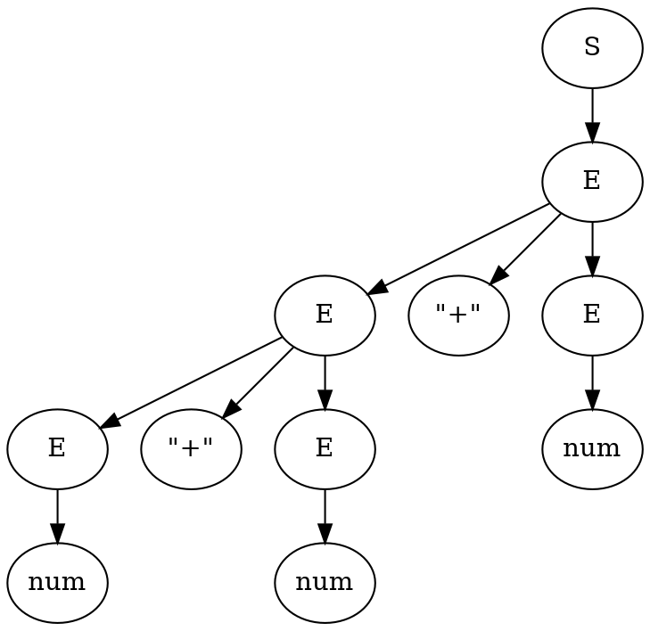

import { Info, Note, Warning, Focus } from '@/components/Info';
import * as Citation from '@/components/Citation';
import * as Table from '@/components/DataTable';

export const metadata = {
  title: 'Parsing 1: Definitions'
};

export const hasReferences = false;

In each chapter I've generally tried to provide an explanation of every single concept used where it is used. Such as the meaning of every variable, and descriptions of any mathematical notation that isn't extremely common.

To get to the starting point where I can do that, I however need to lay out a few basic concepts.

## Basic Definitions

Parsing refers to the process of determining whether a string of symbols belongs to a given language. To define a language we will be using a *grammar*, which consists of a sequence of rules that define how to generate strings belonging to the language of that grammar.

For example the following grammar describes the language of all possible strings of balanced parenthesis:

```txt title="Grammar 1"
S -> "(" S ")" S
S ->
```

The notation used for this grammar, and any others in this article, is defined as follows:

* A *terminal* symbol is represented by either
  * a sequence of lowercase letters, indicating some unspecified sequence of characters (so `a` is not necessarily `"a"`) e.g. `number` or `x`
  * a single quoted character e.g. `"("`, `"a"`, or `"+"`
* A *non-terminal* symbol is denoted by a leading uppercase letter e.g. `Array`, `A`
* A sequence of Symbols separated by spaces refer to the sequence of those symbols one after another e.g. `number "+" number`
* A *production* is denoted with a `->` e.g. `Addition -> number "+" number`

A *production* defines how a string can be generated by replacing the symbols on the left with those on the right. This process begins with some initial symbol, for which I will be using `S`.

So an example of this process using the previously specified grammar would be as follows:

```
S

# by rule 1
"(" S ")" S

# by rule 2
"(" S ")"

# by rule 1
"(" "(" S ")" S ")"

# by rule 2
"(" "(" S ")" ")"

# by rule 2
"(" "(" ")" ")"
```

The language of the grammar contains every string created by any such application of the rules in any order which does not contain any *non-terminal* symbols. Thus the names *terminal* and *non-terminal* refer to whether they appear in the output when the process terminates.

For the purposes of this article we are going to be considering only Context Free Grammars. A grammar is context free if all of its productions only have a single non-terminal on their left hand side.

<Note>
In equations and diagrams I will be using normal letters to refer to concrete named tokens and will be using Greek letters for variables. Specifically I mean the following set of Greek letters.

```math
\begin{align*}
&\Alpha
\Beta
\Gamma
\Delta
\Theta
\Lambda
\Xi
\Pi
\Tau
\Upsilon
\Phi
\Psi
\Omega
\\
&\alpha
\beta
\gamma
\delta
\zeta
\eta
\theta
\iota
\lambda
\mu
\xi
\rho
\sigma
\tau
\upsilon
\phi
\psi
\omega
\end{align*}
```

In all cases a definition of every variable will be provided alongside its usage. I will however make use of the convention of using the lowercase letters for sequences of tokens and uppercase letters for singular tokens.

Note that the usage of $\Alpha\Beta\Tau$ as variables means that the extremely similar looking $ABT$ will never be used as the names of tokens.

Small epsilon ($\epsilon$) is not listed above because it will take its common meaning as "empty" or "nothing".

In addition the following short forms will be used:

* $\mathbb{S}$ is the set of all states
* $\mathbb{V}$ is the set of all possible tokens (V because vocabulary)
* $\mathbb{T}$ is the set of all terminal tokens
* $\mathbb{N}$ is the set of all non-terminal tokens
* $\mathbb{P}$ is the set of all productions
</Note>

### Parse Trees

While earlier I stated that a parser merely identifies whether a string is in a language, the output we actually want from it is usually a parse tree.

A parse tree being a tree where each leaf node is labelled with a terminal symbol and each internal node is labelled with a non terminal which can be transformed by some production rules to produce its child nodes.

For an example consider this simple grammar:

```txt title="Grammar 2"
S -> E
E -> E "+" E
E -> num
```

Using this grammar we can perform a sequence of productions and produce the associated parse tree such as the following:

```
S
E
E "+" E
E "+" num
E "+" E "+" num
E "+" num "+" num
num "+" num "+" num
```



In this example we always replaced the rightmost non-terminal first, which is called a *rightmost derivation*. The `LR` in `LR` parser is short for `L`eft-to-right, `R`ightmost derivation in reverse.

So a `LR` parser specifically generates a rightmost derivation parse tree, and it does so from bottom to top (thus in reverse).

<Focus>
If we are able to construct a parse tree corresponding to a given string of symbols, then that string must be a part of the language of the associated grammar.

The function of the parser is thus to generate such a parse tree. Conveniently we can then make use of the parse tree afterwards as a symbolic representation of the input string.
</Focus>

### Lexing

For `LR` parsing you typically consider a sequence of tokens rather than simply a sequence of input characters. While it may be possible to create a `LR` parser where you consider each character as a symbol, this would obviously require an enormous increase in the number productions required to describe the language.

That increase in productions would also increase the size of the resulting parser likely making it infeasible to use.

The task of a lexer is to process the input characters into that sequence of tokens. Each token containing a terminal symbol, the token type, as well as some value describing the associated input characters. The parser the considers only the type of each token in its logic.

There aren't really strict rules for writing a lexer, you can do whatever you think you need.

The most common variant is where you define a series of regular expressions, each having an associated terminal symbol. Then splitting the input string up by trying each regex in order anchored at the start of string, making a token from the first one that matches, then repeating the process taking the character after the end of the last match as the start of the string.

I'm going to ignore lexing from here on.

## LR(k)

A `LR(k)` parser is an `LR` parser which makes use of `k` symbols of lookahead as it operates. In theory `k` can be any natural number, but in practice even `LR(1)` parsers are often not usable because the of how the number of parser states increases very quickly with `k`.

A `LR(1)` parser is powerful enough to recognize most programming languages, while a `LR(0)` parser is often insufficient for such a task. Having `k` greater than 1 does not enable the recognition of any additional languages.

Given these facts most `LR` parsers are of some variant that extends `LR(0)` slightly, such as `LALR` and `SLR` parsers.

To describe how to build these more powerful parser variants I'm going to start with `LR(0)`, then describe techniques for taking those parsers and building more powerful parsers based on that foundation.

## Code Samples

All of the code for these articles is written in ruby so that it is runnable but also should be at least somewhat comprehensible to anyone who has written code.

To make things easier to understand however I have tried to avoid ruby-isms that are overly difficult to translate into other languages. Though there are a number of cases where I will rely on merely providing a comment to explain what a method or feature does.

<Info>
Some helpful things to be aware of if you are less familiar with ruby:

* The `?` and `!` characters are allowed in method names
* The function for checking if an item is in a collection is called `include?` instead of something like `contains`
* Ruby allows the `()` to be omitted on method invocations. Here I have only done this on methods invoked without arguments.
* Ruby allows `do`/`end` to be used in place of `{}` for defining closures.
* Ruby generally uses the `each` method in place of a `for ... in` loop.
</Info>
