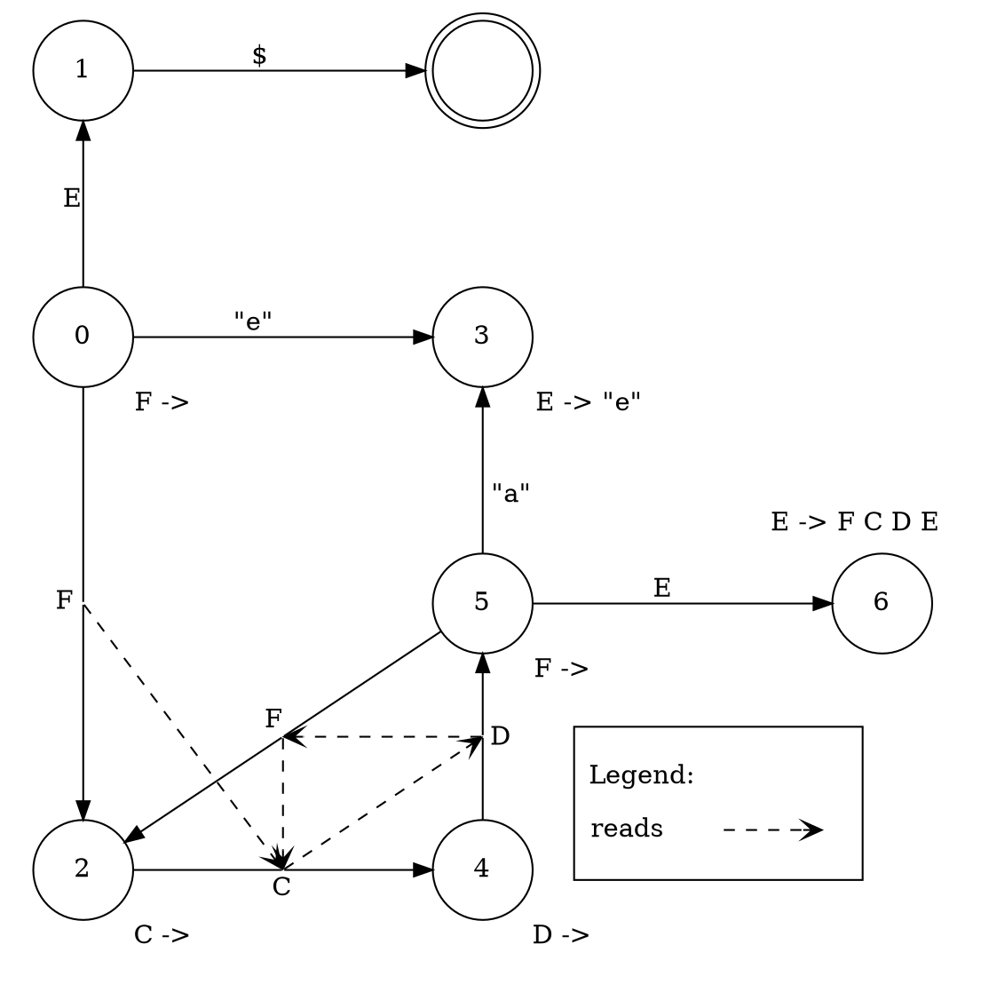
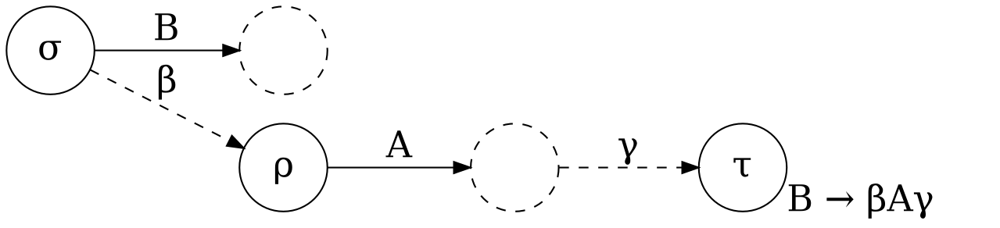
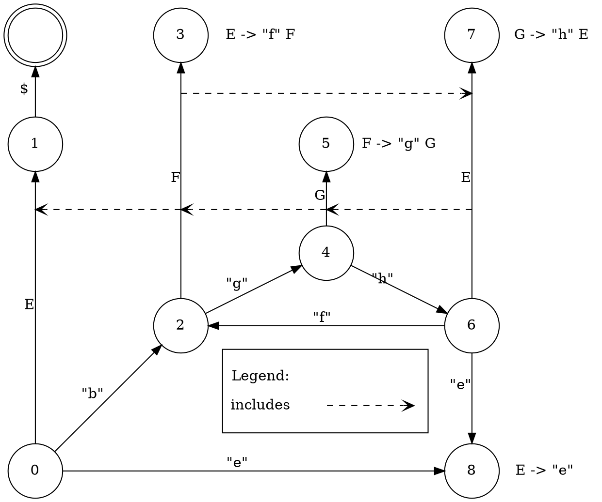
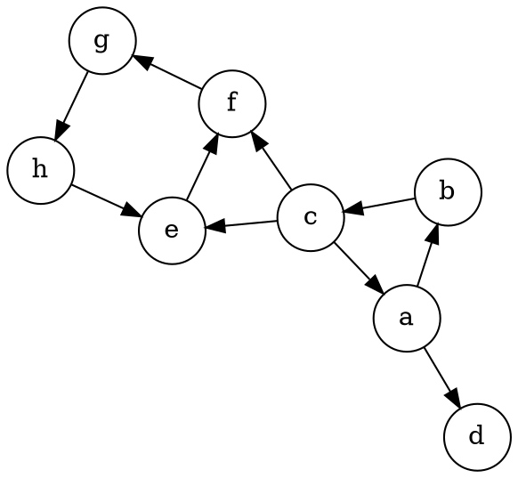

import { Info, Note, Warning, Focus } from '@/components/Info';
import * as Citation from '@/components/Citation';
import * as Table from '@/components/DataTable';
import { Bibliography, CitationProvider } from '@/components/Citation';
import ExampleCode from '@/app/parsing/_components/ExampleCode';

export const metadata = {
  title: 'Parsing 3: LALR(1)'
};
export const hasReferences = true;

<CitationProvider value={[
  {
    type: "article",
    author: "F. DeRemer and T. Pennello",
    title: "Efficient Computation of LALR(1) Look-Ahead sets",
    journal: "ACM Transactions on Programming Languages and Systems",
    volume: 4,
    number: 4,
    year: "1982",
    month: "Oct",
    pages: "615-649",
    doi: "https://doi.org/10.1145/69622.357187",
  }
]}>

A `LALR(1)` parser refers to a `L`ook-`A`head `LR` parser(with 1 token of lookahead).

Specifically a `LALR(1)` parser adds lookahead to a `LR(0)` parser keeping the same set of underlying states. This grants a substantial portion of the additional recognition power of `LR(1)`.

In addition to the parser states being unchanged, the $Next(\rho, \Tau)$ function from the `LR(0)` parser is also used as is, but with $\Tau$ now referring to the lookahead token rather than the shift token.

What we need to compute is thus the values of the function $Reduce_1(\rho, \Tau)$, which are the reductions to perform in a state $\rho$ given that the lookahead token is $\Tau$ (where $\Tau$ is a terminal).

<Info>
Thus if we defined $Reduce_1$ for a `LR(0)` parser we would do so as follows:

```math
Reduce_1(\rho, \Tau) = Reduce_0(\rho)
```

Completely ignoring $\Tau$ like this should remind you of how back in the section on parse tables I mentioned the convention of filling in the reduction for every possible token in a row.
</Info>

### Definitions

We compute $Reduce_1$ through a series of steps which are described by the following equations, such that each step depends on the one below it.

This is going to be a lot all at once so it will likely be more useful as something to come back and refer to rather than an overview of what is to come.

```math
\begin{align*}
Reduce_1(\rho, \Tau) &= \{ \Alpha \rightarrow \omega\in \mathbb{P} \| \Tau \in LA(\rho, \Alpha \rightarrow \omega) \} \\

LA(\rho, \Alpha \rightarrow \omega) &= \bigcup_{\sigma\in \mathbb{S}} \{
  Follow(\sigma, \Alpha) \| (\rho, \Alpha \rightarrow \omega)\ \bm{lookback}\ (\sigma, \Alpha)
\} \\

Follow(\rho, \Alpha) &= Read(\rho, \Alpha) \cup \bigcup_{
  \begin{subarray}{c}
    \sigma\in\mathbb{S}\\
    \Beta\in\mathbb{N}
  \end{subarray}
} \{
  Follow(\sigma, \Beta) \| (\rho, \Alpha)\ \bm{includes}\ (\sigma, \Beta)
\} \\

Read(\rho, \Alpha) &= DR(\rho, \Alpha) \cup \bigcup_{
\begin{subarray}{c}
  \sigma\in\mathbb{S}\\
  \Beta\in\mathbb{N}
\end{subarray}
} \{
  Read(\sigma, \Beta) \| (\rho, \Alpha)\ \bm{reads}\ (\sigma, \Beta)
\} \\

DR(\rho, \Alpha) &= \{ \Tau \in \mathbb{T} \| \rho\xmapsto{\Alpha}\sigma\xmapsto{\Tau} \}
\end{align*}
```

<Focus>
To explain all of the new notation introduced above.

$\bigcup\{\dots\}$ is the recursive union of all of the specified sets, which will be explained further as we describe the Digraph algorithm for computing it.

$\rho\xmapsto{\Alpha}$ represents the transition from state $\rho$ for the token $\Alpha$. Such that appearing to the right of the $|$ means that the expression to the left is conditional on the existence of such a transition.

$LA$ is short for Look Ahead.

$DR$ is short for Directly Reads, and it is the set of terminals that can be read directly after a given non-terminal transition.

$(\rho, \Alpha \rightarrow \omega)\ \bm{lookback}\ (\sigma, \Alpha)$, $(\rho, \Alpha)\ \bm{includes}\ (\sigma, \Beta)$ and $(\rho, \Alpha)\ \bm{reads}\ (\sigma, \Beta)$ mean that there exist edges defined by the $\bm{lookback}$, $\bm{includes}$ and $\bm{reads}$ relations respectively.

Here *relation* refers specifically to such a set of edges between edges (or alternatively a function from pairs to pairs). We will get to explaining these in a moment.
</Focus>

### Relations

To compute $LA$ we now need to determine values for the $\bm{lookback}$, $\bm{includes}$ and $\bm{reads}$ relations. Like $DR$ these can be deduced from the `LR(0)` parser.

We define $\bm{reads}$ such that $(\rho, \Alpha)\ \bm{reads}\ (\sigma, \Beta)$ if and only if all of the following are true

```math
\begin{align*}
&\rho\xmapsto{\Alpha}\sigma \\
&\sigma\xmapsto{\Beta} \\
&\Beta\Rightarrow^\ast\epsilon
\end{align*}
```

<Focus>
Where $\Beta$ and $\Alpha$ are non-terminals and $\rho$ and $\sigma$ are states.

The notation $\Beta\Rightarrow^\ast\epsilon$ means that there exists some sequence of productions starting at $\epsilon$ and resulting in $\Beta$.
</Focus>

This is used in the $Read$ function above to define the full list of terminals which can be the next terminal read after a given non-terminal transition.

As for what this looks like we can have a look at the graph generated for the following grammar:

```txt title="Grammar 4"
S -> E

E -> F C D E
E -> "e"

F ->
C ->
D ->
```



We define $\bm{includes}$ such that $(\rho, \Alpha)\ \bm{includes}\ (\sigma, \Beta)$ if and only if all of the following are true.

```math
\begin{align*}
  &\sigma \xrightarrow{\beta} \rho\\
  &Next(\rho, \Alpha) \xrightarrow{\gamma}\tau\\
  &\gamma\Rightarrow^*\epsilon\\
  &\Beta\rightarrow\beta\Alpha\gamma \in Reduce_0(\tau)
\end{align*}
```

<Focus>
Where $\Beta$ and $\Alpha$ are non-terminals; $\rho$, $\sigma$, and $\tau$ are states; $\beta$ is a sequence of tokens; and $\gamma$ is a sequence of non-terminals.

$\sigma \xrightarrow{\beta} \rho$ means that, given $\beta$ is some sequence of tokens, if we start at state $\sigma$ and follow the sequence of transitions labelled by the tokens of $\beta$, we arrive at state $\rho$. Note that if $\beta=\epsilon$ then $\sigma = \rho$ because traversing a path of length 0 means staying in place.

$\gamma$ is allowed to be an empty string in the above, in which case $Next(\rho,\Alpha)=\tau$.

$Reduce_0$ is from the associated `LR(0)` parser.
</Focus>

The $\bm{includes}$ relation captures what edges can follow the specified edge after taking into account backtracking from performing a reduction.



The following is an example grammar and parser diagram to illustrate what $\bm{includes}$ looks like in practice.

```txt title="Grammar 5"
S -> E
E -> "f" F
E -> "e"

F -> "g" G
G -> "h" E
```



The $\bm{lookback}$ relation is a bit different from the others because it does not relate transitions to transitions.

Unfortunately that means it doesn't have such a nice graphical representation to help illustrate it, but computing it will be very similar to computing $\bm{includes}$.

We define $\bm{lookback}$ such that $(\rho, \Alpha \rightarrow \omega)\ \bm{lookback}\ (\sigma, \Alpha)$ if and only if all of following are true.

```math
\begin{align*}
  &\sigma\xrightarrow{\omega}\rho\\
  &\rho\xmapsto{\Alpha}
\end{align*}
```

<Focus>
Where $\Alpha$ is a non-terminal; $\rho$ and $\sigma$ are states; and $\omega$ is a sequence of tokens.
</Focus>

### The Digraph Algorithm

To compute $Read$ and $Follow$ from their respective relations we need to make use of a graph algorithm referred to as `Digraph`.

The way these two functions are defined, each *strongly connected component* of the relation graph converges to the same value for each vertex in the component, then the other components have dependencies on that value as if the whole component was a single vertex.

<Info>
In a directed graph a node's *strongly connected component*, or SCC, is composed of every other reachable node which can also reach the starting node.

</Info>

The `Digraph` algorithm is a modified SCC traversal algorithm which computes a specific form of graph function as it does so. Namely one in the following form:

```math
\Lambda(\rho,\Alpha) = \lambda(\rho,\Alpha) \cup \bigcup \{ \Lambda(\sigma,\Beta)\,|\,(\rho,\Alpha)\ \Xi\ (\sigma,\Beta) \}
```

Where $\Lambda$ is what we are trying to compute, $\lambda$ is some function we know how to compute without the use of $\Lambda$, and $\Xi$ is a relation.

<ExampleCode identifier="LrExamples::Digraph#digraph" />

<Note>
The original formulation of this algorithm is considerably simpler but accomplishes that with an inner recursive function. I've unwound it here as that is generally the desired form and the transformation is non-trivial.
</Note>

### Computing LA

The steps of the algorithm are as follows:

1. Compute nullable non-terminals from the grammar
2. Compute $DR$ for each transition from the `LR(0)` parser
3. Compute the $\bm{reads}$ from the `LR(0)` parser
4. Apply Digraph to $\bm{reads}$ and $DR$ to compute $Read$
5. Compute $\bm{includes}$ and $\bm{lookback}$ from the `LR(0)` parser
6. Apply Digraph to $\bm{includes}$ and $Read$ to compute $Follow$
7. Union all of the follow sets for each reduction as defined by $\bm{lookback}$ to compute $LA$

I will include explanations of some of the less obvious elements of the above however, rather than post the whole implementation with little discussion, I will direct you to the full example source in [lalr.rb](https://github.com/BenoitHiller/lr_examples/blob/main/lib/lr_examples/lalr.rb) for all of the remaining details.

#### Nullable Non-terminals

The process of computing the nullable non-terminals is obvious, but non-trivial. Here is an example of an algorithm to do so making use of something very similar to the digraph algorithm to recursively traverse the tree.

There are certainly some clever tricks that can be used to cut this down.

<ExampleCode identifier="LrExamples::Lr0#nullable_tokens" />

#### includes and lookback

<ExampleCode identifier="LrExamples::Lalr#compute_path_relations" />

#### Using Digraph

Once we've completed generating the relations, computing the $Read$ and $Follow$ functions is incredibly straightforward. Literally just filling in the arguments as described e.g.

<ExampleCode identifier="LrExamples::Lalr#read" />

#### Putting it all Together

Then the final step of computing $LA$ is just merging everything together. In the code here this is combined with the step of generating the value of $Reduce_1$.

<ExampleCode identifier="LrExamples::Lalr#reduce" />

### Ambiguity

Like with a `LR(0)` parser, a grammar is only considered to be in `LALR(1)` if the parser generated by the described algorithm is unambiguous.

Thus the output needs to be checked to ensure that each edge only corresponds to a single action, either shift or reduce.

Some additional checks can be performed during the steps which make use of the digraph algorithm to identify grammars which are not `LR` at all. See <Citation.Reference style="minimal" author="DeRemer and Pennello" /> for more details.

<Bibliography />
</CitationProvider>
