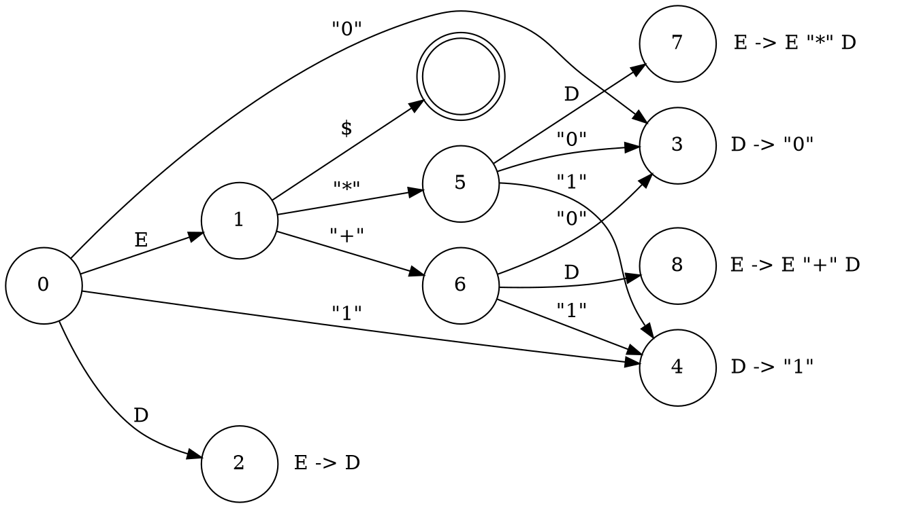

import { Info, Note, Warning, Focus } from '@/components/Info';
import * as Citation from '@/components/Citation';
import * as Table from '@/components/DataTable';
import { Bibliography, CitationProvider } from '@/components/Citation';
import ExampleCode from '@/app/parsing/_components/ExampleCode';

export const metadata = {
  title: 'Parsing 2: LR(0)'
};

<CitationProvider value={[
  {
    type: "article",
    author: "F. DeRemer and T. Pennello",
    title: "Efficient Computation of LALR(1) Look-Ahead sets",
    journal: "ACM Transactions on Programming Languages and Systems",
    volume: 4,
    number: 4,
    year: "1982",
    month: "Oct",
    pages: "615-649",
    doi: "https://doi.org/10.1145/69622.357187",
  }
]}>

The `LR(0)` parser we are going to create will be defined by the following two functions:

* $Next(\rho, \Tau)$ which returns the next parser state to move to from the state $\rho$ given that the next token processed is $\Tau$.
* $Reduce_0(\rho)$ which returns a set of reductions to perform in a given state $\rho$.

For example consider the following grammar and corresponding $Next$ and $Reduce_0$ values:

```txt title="Grammar 3"
0. S -> E

1. E -> E "*" D
2. E -> E "+" D
3. E -> D

4. D -> "0"
5. D -> "1"
```

<Table.Table>
  <Table.Head headings={['State', ['Next', ['$', '"*"', '"+"', '"0"', '"1"', 'E', 'D']], 'Reduce']} />
  <Table.Body>
  | 0     |   |   |   | 3 | 4 | 1 | 2 |   |
  | 1     | $ | 5 | 6 |   |   |   |   |   |
  | 2     |   |   |   |   |   |   |   | 3 |
  | 3     |   |   |   |   |   |   |   | 4 |
  | 4     |   |   |   |   |   |   |   | 5 |
  | 5     |   |   |   | 3 | 4 |   | 7 |   |
  | 6     |   |   |   | 3 | 4 |   | 8 |   |
  | 7     |   |   |   |   |   |   |   | 1 |
  | 8     |   |   |   |   |   |   |   | 2 |
  </Table.Body>
</Table.Table>

<Info>
  In the above the `$` character is used for two purposes:
  1. It represents an EOF symbol which the lexer returns at the end of input.
  2. It indicates where the parser should stop and accept the parse as valid.
</Info>

The parser makes use of this table through the following algorithm:

```ruby
stack = [0]
while true
  state = stack[-1]
  if Reduce0(state)
    apply_reduction(Reduce0(state), stack)

    token = stack[-1]
    state = stack[-2]
    stack.push(Next(state, token))
  else
    # This is the "shift" case

    token = lexer.next

    if Next(state, token)
      if token == "$"
        # If the token to be shifted is the EOF token we stop now.
        #
        # This is preferred over detecting when production 0 is
        # reduced as we don't usually want the start token in the
        # output.
        break
      else
        stack.push(token)
        stack.push(Next(state, token))
      end
    else
      raise "parse error: invalid token"
    end
  end
end
```

With `apply_reduction` being the following:

```ruby
def apply_reduction(reduction, stack)
  # Where the length of a reduction is the number of symbols on its
  # right hand side
  reduction_length = REDUCTION_LENGTHS[reduction]

  if reduction_length > 0
    popped_values = stack.pop(2 * reduction_length - 1)
  else
    popped_values = []
  end

  # Where make_non_terminal is assumed to create a token whose type
  # corresponds to the left hand side of the specified reduction.
  #
  # The popped values are passed in assuming that the ones
  # corresponding to tokens get saved into either the returned token
  # or some separate structure for keeping track of them.
  stack.push(make_non_terminal(reduction, popped_values))
end

```
<Note>
In the discussion of a `LR(0)` parser so far I've been using somewhat unconventional notation for a few things. In place of the $Next$ and $Reduce_0$ table above, usually the same information is presented in the following form:

<Table.Table>
  <Table.Head headings={['state', ['action', ['$', '"*"', '"+"', '"0"', '"1"']], ['goto', ['E', 'D']]]} />
  <Table.Body>
  | 0     |   |   |   |s3 |s4 | 1 | 2 |
  | 1     |acc|s5 |s6 |   |   |   |   |
  | 2     |r3 |r3 |r3 |r3 |r3 |   |   |
  | 3     |r4 |r4 |r4 |r4 |r4 |   |   |
  | 4     |r5 |r5 |r5 |r5 |r5 |   |   |
  | 5     |   |   |   |s3 |s4 |   | 7 |
  | 6     |   |   |   |s3 |s4 |   | 8 |
  | 7     |r1 |r1 |r1 |r1 |r1 |   |   |
  | 8     |r2 |r2 |r2 |r2 |r2 |   |   |
  </Table.Body>
</Table.Table>

The split of the table into `goto` and `action` is mostly arbitrary, but as you can see here `goto` tends to be a lot more sparse than action and that property can be used to compress the table further.

The reasons I've gone with the notation I have are that:

1. The $Next$ and $Reduce_0$ form is what is used by <Citation.Reference author="DeRemer and Pennello" /> in their `LALR(1)` algorithm.
2. I've found encoding action type into the tables makes the algorithms much harder to present, interleaving decoding that information complicates things more than you would expect.
</Note>

### Parse Tables

Along with the $Next$ and $Reduce_0$ values specified before we also need to identify what the parser states actually are.

Let us define a parser state as simply being a natural number which identifies it. Then we can define a bijective function from *state* to *parse table*, meaning each *state* corresponds to exactly one *parse table*.

Each *parse table* is a subset of the possible *items* for the parser. A `LR(0)` parser *item* is a pair $(\rho, \gamma)$ where $\rho$ is the number of a production and $\gamma$ is an index into the right hand side of that production.

To make things easier to follow items are usually represented as the production written out with a `.` at the desired index and surrounded with square brackets.

A few examples from Grammar 3:

```
(1, 0) is
[E -> . E "*" D]

(2, 2) is
[E -> E "+" . D]

(5, 1) is
[D -> "1" .]
```

To avoid having to actually work with pairs in our algorithms we will use a convention of assigning an id to each item as follows.

```ruby
i = 0
@item_ids = {}
@initial_items = {}
for production in @productions
  @initial_items[production.id] = i

  for index in 0..production.length
    @item_ids[[production.id, index]] = i
    i += 1
  end
end
```

This gives us a simple representation of each item which behaves well for set operations, but which we can easily use to associate additional data with each item by simply making an array of length equal to the number of items.

Similarly we will assign sequential ids to each token, first to each terminal then to each non-terminal (so that we can later tell them apart by checking if the id is less than the number of terminals).

<Warning>
  Something to note is that we are going to be making use of negative values to encode additional information later on. **That means that you must be extremely careful with assigning the id of 0**.

  I'm writing everything here under the assumption that token 0 is always the special EOF token, which enables us to ignore it in many cases where you would otherwise get nasty collisions. It may be easier to just start counting both productions and tokens at 1 to avoid issues.
</Warning>

### Closure and Successors

To determine the states and parse tables we make use of two functions

* $Closure$ which takes a set of items and returns the set of all items that must be a part of the same set as the input
* $Successors$ which takes a set of items and produces a set of sets of items where each set contains the items that result from shifting a different symbol.

$Closure$ is defined recursively as

```math
\begin{alignat*}{4}
  &Closure(\Gamma) = \Gamma \cup Closure(
    \{
      [ \Alpha \rightarrow \cdot \ \omega ] \, | \\
        &\qquad [ \Beta \rightarrow \alpha \cdot \Alpha \beta ] \in \Gamma \allowbreak\ \textup{and} \ \Alpha \rightarrow \omega \in \mathbb{P} \\
    &\}
    \setminus \Gamma
  )
\end{alignat*}
```

<Focus>
Where $\alpha$, $\beta$, and $\omega$ represent arbitrary sequences of tokens(which may be empty) and $\Alpha$ and $\Beta$ are arbitrary non-terminals.

The $\Gamma$ parameter must be some set of items.
</Focus>

$Successors$ is defined as

```math
Successors(\Gamma) = \{ Nucleus(\Gamma, \Tau)\, |\, \Tau \in \mathbb{V} \}
```

Where $Nucleus$ is a helper function which produces the set of shifted items where the token shifted is some $\Tau$

```math
Nucleus(\Gamma, \Tau) = \{ \Alpha \rightarrow \alpha \Tau \cdot \beta \, | \, \Alpha \rightarrow \alpha \cdot \Tau \beta \in \Gamma \}
```

#### Items Array

To compute these things in our code we are going to to make use of our item ids from earlier to create a helpful array called `@items`.

`@items` will contain, for each item id, the id of the next token in that production, when it exists. The last item for each production has no next token so instead in those locations we will store a non token value to identify them later. The non token value we use is `-production_id`.

#### Example Code

<ExampleCode identifier="LrExamples::Lr0#successors" />
<ExampleCode identifier="LrExamples::Lr0#closure" />

### Computing Parse Tables

Finally we can put these tools together to compute the `LR(0)` parse tables and their associated $Next$ and $Reduce_0$ values.

The following code populates `@table_states` with a mapping from item set to state id. The inverse mapping is available as `@table_states.inverted`.

<ExampleCode identifier="LrExamples::Lr0#build_table_states!" />

### What This Looks Like

For grammar 3 the above algorithm produces the following parse tables:

```
Table 0 {
  [Start -> . E $] (E, 1)
  [E -> . E "*" D] (E, 1)
  [E -> . E "+" D] (E, 1)
  [E -> . D] (D, 2)
  [D -> . "0"] ("0", 3)
  [D -> . "1"] ("1", 4)
}

Table 1 {
  [Start -> E . $] ($, accept)
  [E -> E . "*" D] ("*", 5)
  [E -> E . "+" D] ("+", 6)
}

Table 2 (reduce 3) {
  [E -> D .]
}

Table 3 (reduce 4) {
  [D -> "0" .]
}

Table 4 (reduce 5) {
  [D -> "1" .]
}

Table 5 {
  [E -> E "*" . D] (D, 7)
  [D -> . "0"] ("0", 3)
  [D -> . "1"] ("1", 4)
}

Table 6 {
  [E -> E "+" . D] (D, 8)
  [D -> . "0"] ("0", 3)
  [D -> . "1"] ("1", 4)
}

Table 7 (reduce 1) {
  [E -> E "*" D .]
}

Table 8 (reduce 2) {
  [E -> E "+" D .]
}
```

The annotations here next to the table numbers denote the values of $Reduce_0$ for a given state. In each table $\sigma$ the pair of values $(\Tau, \rho)$ represent the contents of $Next$ such that $Next(\sigma, \Tau) = \rho$.

For the algorithms that follow we are also going to make heavy use of the following graph representation of a parser, where each $\sigma$ is a vertex and $Next$ defines an edge to $\rho$ labelled with $\Tau$.



<Info>
To trace out the process of parsing using the graph you need to keep track of the stack of previous states.

When reaching a state annotated with a given production you walk backwards through your stack by 1 state for each token appearing on the right hand side of the production, after which you follow the edge annotated with the left hand side of the production.

On reaching any other state you would simply fetch the next input symbol and follow the corresponding edge.
</Info>

## Ambiguity

The above algorithm will generate `LR(0)` parse tables regardless of whether the language being parsed is actually recognizable by a `LR(0)` parser.

In those cases the resulting parse table will contain conflicts. Either shift-reduce conflicts, where a state is labelled with both a reduction and shift actions, or reduce-reduce conflicts, where a state has multiple reduce actions.

In both cases the parser is not able to determine what action to take in such states, and so will not function when used in the manner described before. When this happens we say that the parser is ambiguous.

<Focus>
A grammar is considered to be *in* `LR(0)` if and only if the generated parser is unambiguous.

A language is considered to be *in* `LR(0)` if and only if there exists a grammar in `LR(0)` that recognizes it.
</Focus>

That does imply that in some cases ambiguity can be resolved by producing a different grammar that represents the same language. It is in fact often the case when writing `LR` parsers that you need to make repeated adjustments to a grammar to reduce ambiguity.

When a language is not in `LR(0)`, we will instead need a more powerful parser.

<Bibliography />
</CitationProvider>
